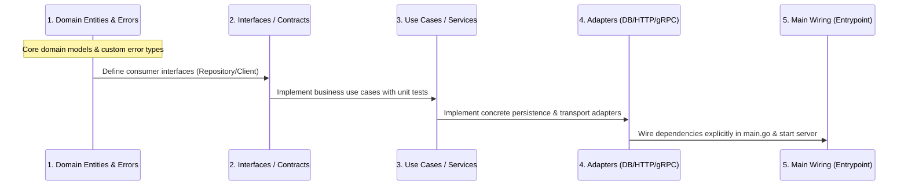

# Greenfield & Brownfield Standard Operating Procedures (SOP)

---

## 1. Greenfield Scaffolding SOP

Construct new Go projects in stages following this sequence:

### Stage 1: Environment & Dependency Initialization
1. **Initialize Module & Set Version Baseline**:
   ```bash
   go mod init <module-path>
   go mod edit -go=1.26   # Target a currently supported release (Go supports the latest two)
   ```
2. **Pin Developer Tools in `go.mod`** (Go 1.24+ `tool` directive; no `tools.go`, no `@latest` in scripts):
   ```bash
   go get -tool golang.org/x/vuln/cmd/govulncheck@latest
   go tool govulncheck ./...
   ```
3. **Setup Core Toolchain**:
   - Add `.golangci.yml` (Static analysis baseline, see [golangci.yml](../templates/golangci.yml)).
   - Add `Makefile` (Standard targets incl. `make check`, see [Makefile](../templates/Makefile)).
   - Configure `.gitignore` (Ignore `bin/`, `.env`, `coverage.out`).

### Stage 2: Bottom-Up Scaffolding Pipeline
Generate code strictly from the bottom up to preserve dependency inversion:



### Stage 3: Server Startup & Graceful Shutdown (Production Template)
Inside `cmd/<app>/main.go`. `main` only configures logging and converts `run()`'s error into an exit code, so deferred cleanup always runs:

```go
package main

import (
	"context"
	"errors"
	"fmt"
	"log/slog"
	"net/http"
	"os"
	"os/signal"
	"syscall"
	"time"
)

func main() {
	slog.SetDefault(slog.New(slog.NewJSONHandler(os.Stdout, &slog.HandlerOptions{Level: slog.LevelInfo})))

	if err := run(); err != nil {
		slog.Error("application exited with error", slog.Any("error", err))
		os.Exit(1) // The only os.Exit in the program: after run() returns, all defers have executed.
	}
}

func run() error {
	ctx, stop := signal.NotifyContext(context.Background(), os.Interrupt, syscall.SIGTERM)
	defer stop()

	// Load config, open DB pools, etc. here, each with `defer x.Close()`.
	health := NewHealth(nil) // See logging_and_observability.md §4.

	mux := http.NewServeMux()
	health.Register(mux)
	// Register application routes here (Manual DI: construct repos -> services -> handlers).

	srv := &http.Server{
		Addr:              ":8080",
		Handler:           mux,
		ReadHeaderTimeout: 5 * time.Second, // Slowloris protection (gosec G112)
		ReadTimeout:       10 * time.Second,
		WriteTimeout:      15 * time.Second,
		IdleTimeout:       120 * time.Second,
	}

	errCh := make(chan error, 1)
	var serverWg sync.WaitGroup
	serverWg.Go(func() {
		slog.InfoContext(ctx, "server starting", slog.String("addr", srv.Addr))
		if err := srv.ListenAndServe(); err != nil && !errors.Is(err, http.ErrServerClosed) {
			errCh <- err
		}
		close(errCh)
	})

	select {
	case err := <-errCh:
		return fmt.Errorf("listen: %w", err) // e.g. port already in use
	case <-ctx.Done():
	}

	// Fail readiness first so the load balancer stops routing new traffic, then drain.
	slog.InfoContext(ctx, "shutdown signal received, draining")
	health.StartDraining()
	time.Sleep(3 * time.Second) // Tune to the load balancer's readiness-probe interval; use 0 outside Kubernetes.

	// WithoutCancel keeps ctx values (trace IDs) but not the already-fired cancellation.
	shutdownCtx, cancel := context.WithTimeout(context.WithoutCancel(ctx), 10*time.Second)
	defer cancel()
	if err := srv.Shutdown(shutdownCtx); err != nil {
		return fmt.Errorf("graceful shutdown: %w", err)
	}
	serverWg.Wait() // Guarantees ListenAndServe goroutine has cleanly terminated (rule 4).
	slog.InfoContext(ctx, "server exited cleanly")
	return nil
}
```

> [!TIP]
> When several long-running components exist (HTTP server, workers, consumers), run each under one `errgroup.WithContext(ctx)`. The first one that fails cancels the rest, and `g.Wait()` returns its error to `main`.

---

## 2. Brownfield Modification SOP

Core directives: **Consistency First, Minimal Blast Radius.**

### Step 1: Codebase Inspection (Inspect Before Writing Code)
Before writing any code, scan the codebase and identify conventions:
0. **Go Version & Tooling Inspection** (do this first):
   - Read the `go` (and `toolchain`) directive in `go.mod`. **Never use APIs newer than that version** (see the version table in [modern_go.md](./modern_go.md)). Suggest bumping the version as a separate change if it's needed.
   - Reuse the project's existing `.golangci.yml`, `Makefile`/`Taskfile`, and CI scripts as the source of truth for quality gates; don't overwrite them with the templates.
1. **Logging System Inspection**:
   - Check if the project uses `log/slog`, `uber-go/zap`, `rs/zerolog`, or standard `log`.
   - *Rule*: **Inherit the existing logging library**. Never introduce `slog` into a project using `zap`, nor introduce `zap` into a project using `slog`.
2. **Error Handling Pattern Inspection**:
   - Check if the project uses custom error structs, `pkg/errors`, or standard library `fmt.Errorf("%w")`.
3. **Architecture & Layering Inspection**:
   - Inspect directory layout (MVC, Standard Layout, DDD/Clean).
   - Find similar existing implementations (e.g., when adding an endpoint, review how existing endpoints structure their Handler/Service/Repo).
4. **Test Framework Inspection**:
   - Check if tests use `testify`, `ginkgo`, `gomock`, or pure standard `testing`.

### Step 2: Preserve Backward Compatibility
When adding parameters or functionality to existing functions/structs, **never break exported function signatures directly**. Use one of two backward-compatible approaches:

#### Approach A: Functional Options Pattern
Ideal for configuration, client setup, or complex constructors:

```go
// Existing constructor remains compatible
type Option func(*ClientConfig)

func WithTimeout(d time.Duration) Option {
	return func(c *ClientConfig) {
		c.Timeout = d
	}
}

func WithMaxRetries(retries int) Option {
	return func(c *ClientConfig) {
		c.MaxRetries = retries
	}
}

// Extended constructor supports variadic options
func NewClient(addr string, opts ...Option) *Client {
	cfg := &ClientConfig{
		Timeout:    5 * time.Second, // Preserves legacy default behavior
		MaxRetries: 3,
	}
	for _, opt := range opts {
		opt(cfg)
	}
	return &Client{addr: addr, cfg: cfg}
}
```

#### Approach B: Add Context-Aware or Extended Function Variant
If a function signature must be enhanced (e.g., adding `context.Context` to a legacy function):
```go
// Retain legacy function (delegates internally) and mark Deprecated
// Deprecated: Use DoSomethingWithContext instead.
func DoSomething(param string) error {
	return DoSomethingWithContext(context.Background(), param)
}

// Introduce modern function signature
func DoSomethingWithContext(ctx context.Context, param string) error {
	// Core implementation
	return nil
}
```

### Step 3: Regression Prevention Pipeline
After making changes, execute the following verification steps:
1. **Run existing unit tests**:
   ```bash
   go test -v -run <ModifiedPackageOrTestName> ./...
   ```
2. **Add table-driven tests for newly introduced logic**.
3. **Run race condition detector**:
   ```bash
   go test -race ./...
   ```
4. **Run linter**:
   ```bash
   golangci-lint run
   ```
