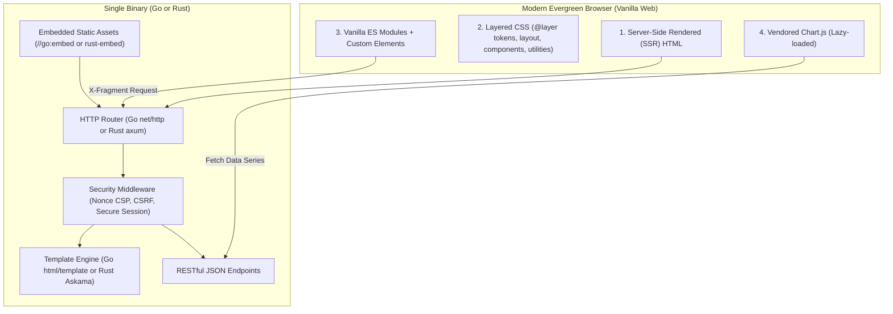

# Architecture & Rendering Principles

This guide details the architectural philosophy, directory layout, rendering model, and fragment protocol for modern server-rendered web dashboards without Node.js or JavaScript build pipelines.

---

## 1. High-Level Architecture Overview

Modern browser standards (CSS `@layer`, OKLCH, container queries, native `<dialog>`, `popover`, ES modules, and Custom Elements) eliminate the traditional necessity of front-end bundlers (Vite, Webpack) and client-side UI frameworks (React, Vue) for administration panels and dashboards.



### Core Architecture Axioms

1. **The Server Owns State & Routing**:
   - The server renders full pages with all structural layouts and data on initial load.
   - The browser URL is the source of truth for dashboard state (`?q=...&status=paid&sort=date&dir=desc&page=2`).
2. **Zero Deployment Runtimes**:
   - The compiled Go or Rust application is a single standalone binary containing all HTML templates, CSS files, JavaScript modules, SVG icons, and vendored libraries.
   - Formal deployment requires zero Node.js, npm, or external CDN dependencies.
3. **Progressive Enhancement via the Fragment Protocol**:
   - Navigation and state changes do not require full-page reloads.
   - Client-side interactions send an `X-Fragment: <targetId>` header. The server responds with only the rendered partial for that element.
   - The client swaps the element in place and synchronizes `window.history`.
4. **Strict CSP & Secure by Default**:
   - No inline scripts without cryptographic nonces (`nonce="..."`).
   - No inline event handlers (`onclick="..."` is strictly prohibited). All events use delegated `data-action` attributes or Custom Elements.
   - Secure cookies with `__Host-` prefix and strict SameSite settings.

---

## 2. Standard Web Layer Directory Layout

Both Go and Rust services follow an identical web layer layout structure:

```text
my-service/
├── internal/web/ (or web/ for Rust)
│   ├── assets.go (or src/web/assets.rs)    # Embedded FS and asset serving
│   ├── templates/                         # Server templates
│   │   ├── layouts/
│   │   │   └── base.html                  # Master shell & HTML skeleton
│   │   ├── partials/                      # Reusable components
│   │   │   ├── sidebar.html               # Navigation sidebar
│   │   │   ├── site_header.html           # Header toolbar & breadcrumbs
│   │   │   ├── section_cards.html         # KPI summary metric cards
│   │   │   ├── chart_area.html            # Analytical chart card
│   │   │   └── data_table.html            # Data table with toolbar & pagination
│   │   └── pages/                         # Route-specific page views
│   │       ├── dashboard.html
│   │       └── users.html
│   └── static/                            # Static assets (compiled into binary)
│       ├── css/
│       │   ├── app.css                    # Layer manifest (@layer)
│       │   ├── tokens.css                 # OKLCH design variables (light & dark)
│       │   ├── base.css                   # Global reset, typography & focus rings
│       │   ├── layout.css                 # Shell layout & container queries
│       │   ├── utilities.css              # Minimal helper classes
│       │   └── components/                # Modular component stylesheets
│       │       ├── button.css
│       │       ├── card.css
│       │       ├── form.css
│       │       ├── table.css
│       │       └── dialog.css
│       ├── js/
│       │   ├── app.js                     # ES module entry point
│       │   ├── core/                      # Core helpers (actions, swap, api, theme)
│       │   │   ├── actions.js
│       │   │   ├── api.js
│       │   │   ├── swap.js
│       │   │   ├── theme.js
│       │   │   └── toast.js
│       │   └── components/                # Custom Elements
│       │       ├── app-sidebar.js
│       │       ├── data-table.js
│       │       └── chart-card.js
│       ├── icons/
│       │   └── sprite.svg                 # Bundled SVG icon symbols
│       └── vendor/
│           └── chart.umd.min.js           # Vendored Chart.js
```

---

## 3. The HTML Fragment Swap Protocol

To achieve SPA-like fluidity without client-side rendering complexity, the system uses a standard request/response fragment contract:

### 3.1 Request Contract
When a link or form specifies `data-swap="target-element-id"`:
- The client dispatches a `fetch()` request to the URL.
- Headers sent:
  ```http
  GET /dashboard/transactions?page=2 HTTP/1.1
  Accept: text/html
  X-Fragment: transactions-table-wrapper
  ```

### 3.2 Server Execution
1. The server checks for the existence of `r.Header.Get("X-Fragment")` (Go) or `headers.get("X-Fragment")` (Rust).
2. If the header is missing: the server renders the full page template within the base layout.
3. If the header is present:
   - **Go**: executes specifically the named partial template:
     ```go
     tmpl.ExecuteTemplate(w, "transactions-table-wrapper", data)
     ```
   - **Rust (Askama)**: renders the specific block fragment via `block = "transactions-table-wrapper"`:
     ```rust
     #[derive(Template)]
     #[template(path = "pages/dashboard.html", block = "transactions_table")]
     struct TableFragmentTemplate<'a> { ... }
     ```
4. The server emits `Vary: X-Fragment` in the response headers.

### 3.3 Client DOM Update
- The client parses the returned HTML fragment inside a `<template>` tag.
- Replaces `document.getElementById(targetId)` with the new element.
- Updates the browser URL bar using `history.pushState` or `history.replaceState`.
- Triggers a custom DOM event:
  ```javascript
  document.dispatchEvent(new CustomEvent('ui:swapped', {
    detail: { targetId, element: next, url }
  }));
  ```

---

## 4. Layer Separation of Concerns

1. **HTML (Structure & Semantic Data)**:
   - Contains pure HTML elements, `class` attributes, `data-action` triggers, and `data-swap` targets.
   - Zero inline CSS styling (`style="..."`).
   - Zero inline event scripts (`onclick="..."`).
2. **CSS (`@layer` Architecture)**:
   - Organized strictly into cascade layers: `tokens`, `base`, `layout`, `components`, `utilities`.
   - Modifiers and component styles reside exclusively in `components/*.css`.
3. **JavaScript (Enhancement Only)**:
   - Pages must remain readable and functional even before JavaScript executes.
   - JS is responsible exclusively for event delegation, client-side dialog toggles, Chart.js canvas rendering, and fragment swapping.
