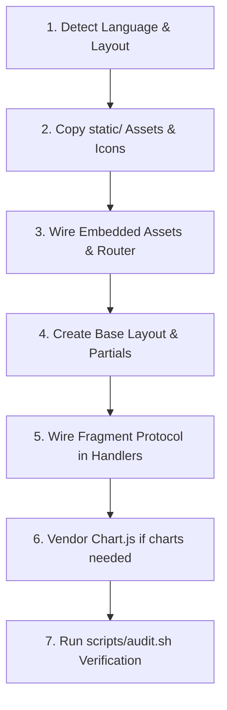

# Workflows & Standard Operating Procedures (SOPs)

This document provides step-by-step SOPs for the five core operations an AI agent or engineer performs on web dashboards: **Create**, **Update**, **Rewrite**, **Improve**, and **Optimize**.

---

## 1. SOP: Create (New Dashboard from Scratch)

Use when creating a brand-new dashboard for a Go or Rust service.

### Step 1: Detect Language & Project Structure
- Check for `go.mod` (Go) or `Cargo.toml` (Rust).
- Target directory convention:
  - Go: `internal/web/{templates,static}`
  - Rust: `web/{templates,static}` and `src/web/`

### Step 2: Copy Static Asset Kit
- Copy `templates/static/css`, `templates/static/js`, and `templates/static/icons` into your project's static folder.

### Step 3: Wire Binary Asset Embedding
- In Go: Create `assets.go` with `//go:embed templates static`.
- In Rust: Implement `#[derive(RustEmbed)]` pointing to `folder = "web/static/"`.

### Step 4: Create Base Layout & Partials
- Create `layouts/base.html` containing the responsive app shell (`<app-sidebar>`, `.site-header`, `.site-main`, `.toast-region`).
- Create page partials:
  - `partials/section_cards.html` (KPI metric cards)
  - `partials/chart_area.html` (traffic analytics)
  - `partials/data_table.html` (data grid with search & pagination)

### Step 5: Wire the Fragment Protocol
- In your HTTP handler, inspect `r.Header.Get("X-Fragment")` (Go) or `headers.get("X-Fragment")` (Rust).
- If present, render only the requested partial template; if absent, render the full page.

### Step 6: Vendor Chart.js (If Applicable)
- Run `vendor_chartjs.sh <target_static_vendor_dir>` to download and verify the checksum of Chart.js.

### Step 7: Audit & Verify
- Run `scripts/audit.sh <web_folder>` to verify zero inline handlers, zero Node.js dependencies, and 100% token usage.

---

## 2. SOP: Update (Adding New Features or Components)

Use when adding a new page, table, metric card, or modal to an existing dashboard.

1. **Locate Component Contract**:
   - Check `references/components.md` for the standard HTML markup and class names.
2. **Add CSS if New Component**:
   - Place component styles in `static/css/components/<name>.css`.
   - Register `@import url("components/<name>.css") layer(components);` inside `static/css/app.css`.
   - Never use raw `#hex` or `rgb(...)` values; use `var(--*)` tokens.
3. **Add Interactivity**:
   - For simple clicks: add `data-action="my-action"` and register the handler in `static/js/core/actions.js` or page script.
   - For modals: use `<dialog id="my-modal" class="dialog">` triggered via `data-action="open-dialog"` and `data-target="my-modal"`.
4. **Dark Mode Verification**:
   - Verify that your additions render cleanly in both light mode and with `.dark` applied to `<html>`.

---

## 3. SOP: Rewrite (Migrating from React/Vue/Tailwind to Native Web)

Use when replacing a bloated client-side SPA or heavy Node-dependent dashboard with native server rendering.

| React / SPA Pattern | Native Server Dashboard Equivalent |
| :--- | :--- |
| `npm run build` / Vite / Webpack | Pure static assets embedded via `//go:embed` or `rust-embed` (Zero Node.js) |
| React Component (`<Card />`) | Server template partial (`{{ template "card" . }}` or Askama partial) |
| `useState` / `useSearchParams` | Browser URL parameters (`?q=...&page=...`) + `swap.js` fragment protocol |
| TanStack Table | Native `<table class="table">` + server pagination + `<data-table>` wrapper |
| Recharts / Chart.js npm package | Vendored `chart.umd.min.js` + `<chart-card>` + `resolveTokenColor()` |
| Tailwind utility soup | Semantic `@layer components` CSS with OKLCH design tokens |
| Client-side routing (React Router) | Native HTML `<a href="...">` enhanced with `data-swap` |

---

## 4. SOP: Improve (UX & Visual Polish Audit)

Use to elevate an existing dashboard to production grade:

1. **Four States Check**:
   - Verify every card, chart, and table provides: loading state (skeleton), empty state, error state, and populated data state.
2. **Zero FOUC (Dark Mode Flash)**:
   - Ensure the server reads the `theme` cookie and outputs `<html class="dark">` on initial response.
3. **Table Usability**:
   - Add debounced search inputs (`300ms`).
   - Add row selection checkboxes with floating bulk action bar.
   - Add sort indicators (`aria-sort` and arrow icons).
4. **Accessibility (a11y)**:
   - Verify keyboard focus rings with `:focus-visible`.
   - Confirm `<app-sidebar>` toggle works with `⌘+B` / `Ctrl+B`.
   - Confirm dialogs trap focus and close with `Escape`.

---

## 5. SOP: Optimize (Performance & Delivery Tuning)

Use when improving dashboard load times, responsiveness, or reducing memory usage:

1. **Verify Chart.js is Lazy-Loaded**:
   - Confirm Chart.js is **not** imported in the global `<head>`. It should be loaded on demand by `<chart-card>`.
2. **Prevent Layout Shifts (CLS)**:
   - Ensure `.chart-canvas-container` has an explicit height in CSS (`280px`).
   - Ensure all icons and avatars have explicit width and height.
3. **Configure Caching & ETags**:
   - Set `Cache-Control: public, max-age=3600` on embedded static routes.
   - Support `If-None-Match` for instant `304 Not Modified` responses.
4. **Run Compliance Audit**:
   - Execute `scripts/audit.sh` to ensure zero regressions.
